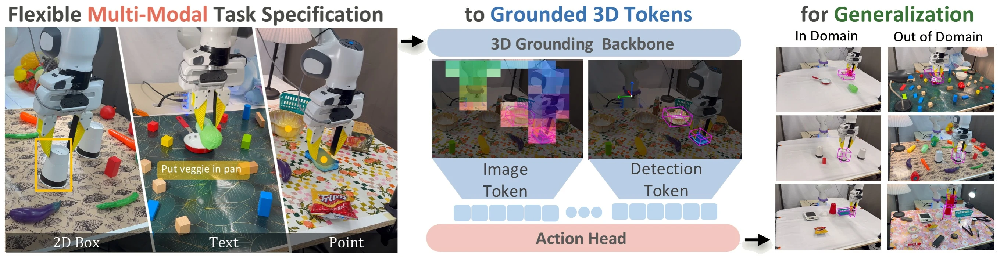

<h1 align="center">Grounded Action Model:<br>3D Grounding as a Foundation for Robotics</h1>

<p align="center">
  <a href="https://arxiv.org/abs/2609.23863"></a>
  <a href="https://grounded-action-model.github.io/"></a>
  <a href="https://huggingface.co/gehaozhang"></a>
  <a href="./LICENSE"></a>
</p>

<p align="center">
  <a href="https://gehaozhang6.github.io/">Gehao Zhang</a><sup>1</sup> ·
  <a href="https://weikaih04.github.io/">Weikai Huang</a><sup>2</sup> ·
  <a href="https://shailes-h.github.io/">Shailesh Shailesh</a><sup>3</sup> ·
  <a href="https://666harrypeng.github.io/">Yiyan Peng</a><sup>1</sup> ·
  <a href="https://jiafei1224.github.io/">Jiafei Duan</a><sup>3</sup> ·
  <a href="https://ranjaykrishna.com/index.html">Ranjay Krishna</a><sup>2</sup>
  <br>
  <sup>1</sup>Northwestern University &nbsp; <sup>2</sup>University of Washington &nbsp;
  <sup>3</sup>National University of Singapore
</p>


https://github.com/user-attachments/assets/78dd3f06-45af-4ca0-a8b6-9a7492162b56


<p align="center">
  
</p>

## 🔥 Overview

GAM makes grounding explicit. Language or a 2D point first **selects the task objects**; a frozen
promptable 3D detector ([WildDet3D](https://github.com/allenai/WildDet3D), built on SAM 3) then supplies each object's **image features, 3D box, size,
orientation and point cloud** in the robot base frame; and a flow-matching transformer predicts
action chunks from those grounded observations, the robot's own silhouette and its proprioception. With `lang_mode: none` (the released checkpoints) the policy
never sees a sentence and never sees the whole image, only the objects it was pointed at and itself.

### Key Features

- **Grounded, object-centric input.** Every object slot is a 3D box + point cloud + masked image tokens from a
  frozen open-vocabulary 3D detector; the policy is conditioned on *where things are*, not on pixels.
- **Any prompt.** Slots come from object names (text prompts on every frame) or from points tracked through the
  episode (a first-frame detection, or any point source you provide).
- **Three ways to train.** Precompute a feature cache and train fast, train from the released caches, or train
  end-to-end with the frozen detector inside the loop (only the object tracks are prepared offline).

<table align="center">
  <tr>
    <td align="center"></td>
    <td align="center"></td>
    <td align="center"></td>
    <td align="center"></td>
  </tr>
  <tr>
    <td align="center"><sub>RoboTwin 2.0, stack_bowls_two (randomized)</sub></td>
    <td align="center"><sub>RoboTwin 2.0, handover_block</sub></td>
    <td align="center"><sub>LIBERO-PRO, libero_10 / object</sub></td>
    <td align="center"><sub>LIBERO-PRO, goal / task</sub></td>
  </tr>
</table>
<p align="center"><sub>Evaluation rollouts of the released checkpoints; the wireframes are the 3D boxes the policy is given at every step.</sub></p>

## ✨ News

- **[2026-10]** LeRobot line: train GAM on any LeRobot dataset from its task strings alone (span head +
  CoTracker, precompute or end-to-end) and evaluate it in your own environment with `GAM.eval.run`.
- **[2026-10]** Benchmark release: training and evaluation code for RoboTwin 2.0 and LIBERO-PRO, with the
  [checkpoints and training caches](#-model-download) on the Hub.
- **[2026-09]** GAM is out on [arXiv](https://arxiv.org/abs/2609.23863).

## 📋 Table of Contents

- [Model Download](#-model-download)
- [Requirements](#-requirements)
- [Installation](#-installation)
- [Data Preparation](#-data-preparation)
- [Training](#-training)
- [Evaluation](#-evaluation)
- [Your Own Dataset](#-your-own-dataset)
- [Language](#-language)
- [License](#-license)
- [Citation](#-citation)

## 📦 Model Download

| Benchmark | Checkpoint | Trained on |
|---|---|---|
| RoboTwin 2.0 | [`gam-robotwin`](https://huggingface.co/gehaozhang/gam-robotwin) | 50 clean demonstrations per task (one expert per task) + the RoboTwin-tuned detector and training caches; task checkpoints still being released |
| LIBERO-PRO | [`gam-libero-pro`](https://huggingface.co/gehaozhang/gam-libero-pro) | all four LIBERO suites, 50 demonstrations per task (one policy) + the LIBERO-tuned detector, span head and training cache |
| Your own dataset | [`gam-wilddet3d`](https://huggingface.co/gehaozhang/gam-wilddet3d) | the general WildDet3D detector and the universal span head |

The LIBERO-PRO task files (bddl + initial states) are in
[`gam-libero-pro-assets`](https://huggingface.co/datasets/gehaozhang/gam-libero-pro-assets). Nothing has to be downloaded by
hand: every config references these repositories as `hf://...` and the files are fetched on first use (cached under `HF_HOME`).

## 💻 Requirements

Linux x86_64, Python 3.11, CUDA 12.6 / 12.8 / 13.0 (torch 2.13). Measured on one L40S:

| Mode | GPU memory | Notes |
|---|---:|---|
| Evaluation, precompute | < 8 GB | detector in fp32 (bf16 at RoboTwin evaluation) |
| Training, RoboTwin | 14 / 19 / 24 / 34 GB | batch 16 / 24 / 32 / 48 per GPU |
| Training, LIBERO-PRO | 9 GB | batch 64 per GPU |
| End-to-end training | training + ~5 GB | the detector stays resident; ~0.6-1 s per sample |

The released checkpoints were trained on 8 GPUs (LIBERO-PRO, global batch 512) and 4 GPUs (RoboTwin, global
batch 192). On a single 24 GB card use `--batch-size 16` and raise `--grad-accum` to keep the global batch
(12 for RoboTwin, 8 for LIBERO-PRO at batch 64); a smaller global batch trains too, but is not the released recipe.

## 🔧 Installation

One Python environment holds GAM and, optionally, the benchmark simulators.

```bash
git clone https://github.com/GehaoZhang6/Grounded-Action-Model && cd Grounded-Action-Model
conda create -n gam python=3.11 && conda activate gam
bash scripts/install.sh                                  # GAM + perception stack (torch cu130 by default: TORCH_INDEX=... to change)
bash scripts/install.sh --libero-pro /path/to/LIBERO-PRO # + LIBERO-PRO
bash scripts/install.sh --robotwin   /path/to/RoboTwin   # + RoboTwin 2.0 (sapien, mplib, curobo built against this torch)
export ROBOTWIN_ROOT=/path/to/RoboTwin                   # RoboTwin only; LIBERO-PRO is imported as a package
```

RoboTwin 2.0 must be the commit the release was evaluated with (later commits restructured the repository and dropped
`script/eval_policy.py`, which our driver builds on):

```bash
git clone https://github.com/RoboTwin-Platform/RoboTwin /path/to/RoboTwin && cd /path/to/RoboTwin && git checkout 6e75b8b
```

RoboTwin's assets are downloaded with its own script (`bash script/_download_assets.sh`), and `ffmpeg` must be on `PATH`
for its evaluation videos.
If you prefer to keep RoboTwin in its own environment, `benchmarks/robotwin/eval.py --sim-python <its python>` runs
the policy as a local server instead.

<details>
<summary><b>Repository layout</b></summary>

```text
GAM/
├── config.py            # YAML loading, ${ENV:-default} / repo:// / hf:// expansion, perception settings
├── hub.py               # hf://user/repo/path -> local file or folder (rate-limit aware)
├── precompute.py        # FrameFeaturizer: frozen detector -> cache (.npz per episode)
├── train.py             # flow-matching policy training (cache or --e2e), torchrun-ready
├── model/               # policy, encoder, transformer, normalizer
├── perception/          # patch_tokens (WildDet3D wrapper), geometry, tracker, arm_render, draw
├── data/                # HDF5 and LeRobot episode readers, cache / e2e datasets, Panda FK
├── text/                # T5 span head: segmenter, phrases, training and label-building scripts
├── tools/               # track (offline CoTracker), verify, viz_cache, eval_offline
└── eval/
    ├── runner.py        # GAMRunner: observation -> action chunk (+ 3D boxes)
    ├── chunker.py       # ActionChunker: replan | tempens | rtc
    ├── run.py           # universal evaluation: any checkpoint, any environment (--env adapter | replay)
    ├── envs.py          # environment adapter protocol + ReplayEnv
    └── inprocess_policy.py  # get_model / eval / reset_model contract for RoboTwin-style harnesses
third_party/             # sam3 / wilddet3d / mdm
benchmarks/
├── libero_pro/          # eval.py run_all.py score.py precompute.py track.py (+ frame_builder, arm_mask, assets/)
├── robotwin/            # eval.py server.py client/ prepare_data.py to_lerobot.py task_config/
└── lerobot/             # inspect_dataset.py train.py
configs/                 # libero_pro.yaml, robotwin/<task>.yaml, {example,lerobot}_{bimanual,single_arm}.yaml
scripts/install.sh
```
</details>

## 📊 Data Preparation

GAM trains on **precomputed features**: the frozen detector is run over every frame once and its outputs (image
tokens, 3D boxes, point clouds) are stored, so training and evaluation of the policy afterwards fit on a single
24 GB GPU (`--batch-size 16 --grad-accum 12` keeps the released global batch of 192). Either download the released caches (point `train.cache_dir` at them
and they train as downloaded):

| Benchmark | `train.cache_dir` | Size |
|---|---|---|
| RoboTwin 2.0 | [`hf://gehaozhang/gam-robotwin/cache/<task>/`](https://huggingface.co/gehaozhang/gam-robotwin/tree/main/cache) | 1-6 GB per task |
| LIBERO-PRO | [`hf://gehaozhang/gam-libero-pro/cache/`](https://huggingface.co/gehaozhang/gam-libero-pro/tree/main/cache) | 11 GB (2000 demonstrations) |

Or precompute your own. LIBERO demonstrations are replayed in the simulator by `benchmarks/libero_pro/precompute.py`
(`LIBERO_DATASETS` = the LIBERO HDF5 root). RoboTwin demonstrations are collected with RoboTwin's own script using the
`gam_collect` task config (1024x768 head camera, clean scene; `eval.py` installs it, or copy
`benchmarks/robotwin/task_config/gam_collect.yml` to `$ROBOTWIN_ROOT/task_config/`), then still frames are marked and the
cache built:

```bash
cd $ROBOTWIN_ROOT && bash collect_data.sh shake_bottle gam_collect 0          # -> data/shake_bottle/gam_collect/data/episode*.hdf5
export ROBOTWIN_DATA=$ROBOTWIN_ROOT/data                                      # what configs/robotwin/*.yaml read
python benchmarks/robotwin/prepare_data.py --data $ROBOTWIN_DATA              # -> $ROBOTWIN_DATA/frames_keep.json
python -m GAM.precompute --config configs/robotwin/shake_bottle.yaml
```

Any other robot follows
`configs/example_bimanual.yaml` / `configs/example_single_arm.yaml` (HDF5 keys) or a LeRobot dataset ([below](#-your-own-dataset)).
Precomputing needs under 8 GB of GPU memory and about 1 s per frame.

## 🚀 Training

Three ways, all driven by the same config (`python -m GAM.train --config <yaml>`):

```bash
# 1. precompute the feature cache from raw demonstrations (see Data Preparation), then train on it
python benchmarks/libero_pro/precompute.py --config configs/libero_pro.yaml --suite object   # x spatial / object / goal / 10
python -m GAM.precompute --config configs/robotwin/shake_bottle.yaml                          # RoboTwin (collected with gam_collect)
python -m GAM.train --config configs/libero_pro.yaml

# 2. train on the released cache: set train.cache_dir to the hf:// folder of the table above
python -m GAM.train --config configs/robotwin/shake_bottle.yaml

# 3. end-to-end: frozen WildDet3D inside the training loop, nothing written to disk
python benchmarks/libero_pro/track.py --config configs/libero_pro.yaml --suite object   # LIBERO: object tracks first (offline CoTracker)
python -m GAM.train --config configs/libero_pro.yaml --e2e
python -m GAM.train --config configs/robotwin/shake_bottle.yaml --e2e
```

Multi-GPU: `torchrun --nproc_per_node 4 -m GAM.train --config ...` (`train.batch_size` is per GPU). The yamls hold
the exact settings of the released checkpoints; on fewer GPUs raise `train.grad_accum` (or `--grad-accum`) to keep
the global batch, otherwise the step count and schedule no longer correspond. Precomputing is fast to train on but
stores roughly 0.3-1 GB per 1000 frames and must be rebuilt when perception settings change;
end-to-end stores nothing and costs one detector forward per sample.

## 🎯 Evaluation

Both simulators need their packages installed ([Installation](#-installation)). The released checkpoints download
automatically; `--ckpt my_policy.pt` evaluates your own instead. LIBERO-PRO is 4 suites x 4 perturbation variants = 16
*cells*, each with 10 tasks (a *unit* is one suite / variant / task triple); RoboTwin 2.0 experts are one policy per task.

### LIBERO-PRO

```bash
python benchmarks/libero_pro/eval.py    --config configs/libero_pro.yaml --suite object --variant language   # one cell
python benchmarks/libero_pro/run_all.py --config configs/libero_pro.yaml --gpus 0,1,2,3                       # all 160 (suite, variant, task) units
python benchmarks/libero_pro/score.py   --config configs/libero_pro.yaml                                      # the table: per cell, the mean of its 10 tasks' success rates
```

How the reported LIBERO-PRO evaluation grounds objects, for transparency: with `perception.text_slots: table` the
instruction is mapped to its object phrases through two lookup tables shipped in `benchmarks/libero_pro/assets/`
(`span_cache.json`, `lang_slots.json`), keyed by the 104 instructions of the benchmark (the language variant's rewrites
included), and the released `span_head_libero_pro.pt` was fine-tuned on labels for those same instructions
(`span_labels.json`); an instruction outside the tables falls back to the span head. `perception.click_shift` in
`configs/libero_pro.yaml` moves the tracker's start point by 8 px for two tasks (object / language and object / object,
task 3). Depth: on LIBERO-PRO the detector is given the simulator's rendered depth image together with the RGB
(`detector_depth: sim`, the same RGB-D observation at training and evaluation), while object geometry still comes from
the detector's own predicted boxes and depth; RoboTwin runs monocular (`detector_depth: zero`). Neither benchmark reads
object poses or any other simulator state; all of the above is in the config.

### RoboTwin 2.0

```bash
python benchmarks/robotwin/eval.py --config configs/robotwin/shake_bottle.yaml --overlay      # clean + randomized, 20 episodes each (eval.episodes)
python benchmarks/robotwin/eval.py --config configs/robotwin/shake_bottle.yaml --sim-python ~/envs/robotwin/bin/python   # RoboTwin in its own env
```

`eval.py` installs the GAM policy client, the `gam_clean` / `gam_randomized` task configs and a small evaluation driver
(`script/eval_policy_gam.py`: the official `eval_policy.py` with the episode count and the output folder made
configurable) into the RoboTwin checkout, then runs the official evaluation loop; results and videos land under
`eval.out_dir/<setting>/`. `--overlay` adds the head camera with the 3D boxes the policy saw (LIBERO-PRO videos carry
the boxes by default).

## 🤖 Your Own Dataset

GAM trains from your own demonstrations with no manual labelling. Two general weights do the grounding, both from
[`gehaozhang/gam-wilddet3d`](https://huggingface.co/gehaozhang/gam-wilddet3d) and already referenced by the templates
(`checkpoints.wilddet3d`, `checkpoints.span_head`; fetched on first use, or download them yourself):

```bash
huggingface-cli download gehaozhang/gam-wilddet3d wilddet3d_general_v1.pt span_head_universal.pt --local-dir checkpoints/
```

- [`wilddet3d_general_v1.pt`](https://huggingface.co/gehaozhang/gam-wilddet3d/blob/main/wilddet3d_general_v1.pt): the general WildDet3D detector (text / point prompts, 2D + 3D boxes, depth), 4.7 GB
- [`span_head_universal.pt`](https://huggingface.co/gehaozhang/gam-wilddet3d/blob/main/span_head_universal.pt): the universal span head: task string → object phrases, 26 MB

Then pick the template for your robot, bimanual
(14-dim joint layout, object geometry in the robot base frame, as RoboTwin 2.0) or single-arm Franka (7 joints + gripper,
object geometry relative to the end effector, as LIBERO), in the format you record in:

| format | template | how it is read |
|---|---|---|
| LeRobot dataset (Hub id or local folder) | `configs/lerobot_bimanual.yaml`, `configs/lerobot_single_arm.yaml` | directly from its files (parquet + mp4, v2.1 / v3.0; no `lerobot` package needed) |
| your own HDF5 | `configs/example_bimanual.yaml`, `configs/example_single_arm.yaml` | `data.*_key` mapped to your layout |

### Train

Single-arm or bimanual is chosen by the template you copy; nothing else switches. The two differ in the state /
action layout, the geometry reference frame (`train.pcd_ref: ee` relative to the end effector vs `none` in the base
frame), the gripper dims and the chunk length; copy one, fill in your dataset / camera / URDF, and keep the rest.

```bash
cp configs/lerobot_single_arm.yaml my_task.yaml        # single-arm Franka: 7 joints + gripper, pcd_ref: ee
cp configs/lerobot_bimanual.yaml   my_task.yaml        # bimanual:          14-dim layout,       pcd_ref: none
# (HDF5 recordings: configs/example_single_arm.yaml / configs/example_bimanual.yaml instead)

python benchmarks/lerobot/inspect_dataset.py user/dataset                   # cameras, resolution, tasks -> the data: lines to paste
python benchmarks/lerobot/train.py --config my_task.yaml --mode precompute  # feature cache once, then fast training (24 GB GPU); --max-episodes 3 --max-steps 10 for a smoke run
python benchmarks/lerobot/train.py --config my_task.yaml --mode e2e         # perception inside the training loop, nothing stored
#   -> runs/<task>/latest.pt (checkpoints.policy for evaluation)

# HDF5 recordings: the same steps, one command each
python -m GAM.tools.track  --config my_task.yaml      # task string -> object tracks (offline CoTracker)
python -m GAM.precompute   --config my_task.yaml      # feature cache   (skip with --e2e below)
python -m GAM.train        --config my_task.yaml      # or: --e2e
```

What to fill in the copied yaml (everything else can stay):

| field | what to put |
|---|---|
| `data.repo_id` / `data.root` | Hub id, or a local dataset folder |
| `data.camera` | the RGB feature of one fixed camera (`inspect_dataset.py` lists them) |
| `data.state_key` / `data.action_key` | joint state and **absolute joint targets** in the template's layout (gripper last) |
| `data.camera_intrinsics` / `camera_extrinsics` | K at the stored resolution; base->camera 3x4 (or the 4x4 camera pose with `extrinsic_is_cam2base: true`) |
| `data.n_slots` | how many objects a task involves (`slots: auto` names them from the task string) |
| `perception.robot` | the robot URDF + joint names for the silhouette mask (optional, recommended) |
| `train.out_dir`, `train.max_steps` | where the checkpoint goes; the released RoboTwin experts used 300 epochs over 50 demonstrations at global batch 192, capped at 12k steps |

The task string is the only annotation: `GAM.tools.track` turns it into object phrases (span head), detects them on
the first frame and follows them through each episode with the offline CoTracker; training prompts the detector with
those points frame by frame. Most recordings carry no depth and no calibration, so the templates use the monocular recipe
(`detector_depth: zero`, `geometry_depth: pred`) with the camera intrinsics / extrinsics from the YAML and, optionally, the
robot URDF for the silhouette mask. The general detector is tuned to no particular scene and may need fine-tuning on a new
robot / camera / object set; its native input is ~1k pixels (letter-boxed to 1008 x 1008), so 640 x 480 or larger
recordings work well and 256 x 256 datasets lose small objects.

### Evaluate

```bash
python -m GAM.eval.run --config my_task.yaml --ckpt runs/my_task/latest.pt --env replay --video              # recorded episodes, open loop
python -m GAM.eval.run --config my_task.yaml --ckpt runs/my_task/latest.pt --env my_robot.py:MyEnv --episodes 20 --video   # your robot / simulator
```

`--env replay` plays the recorded episodes back through the trained checkpoint (action error against the demonstrations
plus a video of the 3D boxes it grounds), the quickest check before touching hardware. For closed-loop evaluation write a
small adapter for your robot or simulator (the full protocol and the replay example are in `GAM/eval/envs.py`):

```python
# my_robot.py
class MyEnv:
    n_episodes = 20
    def __init__(self, cfg): ...                 # connect to the robot / build the simulator (cfg = the yaml)
    def reset(self, episode):                    # start an episode, return its instruction
        ...; return "put the red cup in the sink"
    def observe(self):                           # rgb (H,W,3) uint8, depth (H,W) m or mm (zeros if none), K (3,3), E (3,4) base->cam, state (Dq,)
        return {"rgb": rgb, "depth": depth, "K": K, "E": E, "state": q}
    def step(self, action):                      # execute one action of the checkpoint's layout
        ...; return done, success
    def close(self): ...
```

At test time objects are grounded by name on the first frame and tracked online; `eval.chunking` picks how action chunks
are executed (`replan` | `tempens` | `rtc`). The same two objects deploy on a real robot without the adapter:

```python
from GAM.config import load_yaml
from GAM.eval.runner import GAMRunner          # perception (grounded WildDet3D, URDF mask, geometry) + policy
from GAM.eval.chunker import ActionChunker     # replan | tempens | rtc  (eval.chunking and its sub-section)

cfg = load_yaml("my_task.yaml")
runner = GAMRunner(cfg, "runs/my_task/latest.pt"); chunker = ActionChunker.from_config(cfg["eval"])
runner.reset(instruction, seed=episode); chunker.reset()
while not done:                                # rgb (H,W,3), depth (H,W) m or mm, K (3,3), E (3,4) base->cam, state (Dq,)
    if not chunker.needs_query():
        runner.advance(rgb)                      # text+track grounding: the tracker must see every frame
    a = chunker.act(lambda prefix: runner.act(rgb, depth, K, E, state, prefix)[0])
    robot.step(a)
```

## 🗣️ Language

When `GAM.tools.track` prints the wrong objects for your instructions, this is the part to adjust. The policy never reads the
sentence: a T5 **span head** turns the instruction into the object phrases that become the
detector's prompts (one slot each); reference landmarks after "from / on / next to / ..." are dropped so only the objects
to act on are grounded. The released universal head ([`gehaozhang/gam-wilddet3d/span_head_universal.pt`](https://huggingface.co/gehaozhang/gam-wilddet3d/blob/main/span_head_universal.pt), flan-t5-large +
a 2-layer transformer head), for example: `"pick up the screwdriver from the toolbox and hand it over"` → slots
`["screwdriver"]` (the toolbox is a landmark, not a target).

It was trained on RoboTwin templates, LIBERO, DROID instructions and ~78k LeRobot task strings, so on your own phrasing it
**may need retraining**: label a few hundred of your instructions as `{"instruction": ..., "span": [object phrases]}` and
fine-tune from the released head:

```bash
python -m GAM.text.train_span_head --labels my_labels.json --init hf://gehaozhang/gam-wilddet3d/span_head_universal.pt --out my_span_head.pt
```

then point `checkpoints.span_head` at it. (`python -m GAM.text.train_segmenter` builds a synthetic warm-up set from an
object vocabulary when you have no labels yet.)

## 📜 License

GAM's own code is released under the MIT License (see [LICENSE](LICENSE)). The vendored perception stack in
`third_party/` is not ours and keeps its own licenses and copyright:

| package | upstream | license |
|---|---|---|
| `third_party/sam3` | [SAM 3](https://github.com/facebookresearch/sam3), Meta | [SAM License](third_party/sam3/LICENSE) |
| `third_party/wilddet3d` | [WildDet3D](https://github.com/allenai/WildDet3D), Allen Institute for AI | [SAM License](third_party/wilddet3d/LICENSE) (builds on SAM 3 and LingBot-Depth) |
| `third_party/mdm` | [LingBot-Depth](https://github.com/robbyant/lingbot-depth), Robbyant / Ant Group | [Apache-2.0](third_party/mdm/LICENSE) |

The released WildDet3D weights (general and fine-tuned) inherit the SAM License; CoTracker, a pip dependency used
for point tracking, is released under CC BY-NC 4.0.

## 📖 Citation

```bibtex
@misc{zhang2026groundedactionmodel3d,
  title         = {Grounded Action Model: 3D Grounding as a Foundation for Robotics},
  author        = {Gehao Zhang and Weikai Huang and Shailesh Shailesh and Yiyan Peng and Jiafei Duan and Ranjay Krishna},
  year          = {2026},
  eprint        = {2609.23863},
  archivePrefix = {arXiv},
  primaryClass  = {cs.RO},
  url           = {https://arxiv.org/abs/2609.23863}
}
```
